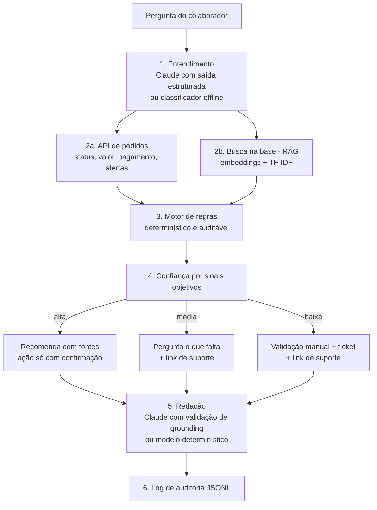

# 🧾 Agente interno de reembolsos e cancelamentos (POC com RAG híbrido)

Prova de conceito de um agente de IA para **colaboradores internos** que tratam reembolsos e cancelamentos em um app de delivery.

O agente consulta as **fontes da verdade** antes de responder, decide com **regras determinísticas**, mede a **confiança** com sinais objetivos e, na dúvida, aciona um **fallback seguro** (validação manual, ticket e link de suporte) em vez de inventar uma resposta.

> Base de conhecimento simulada, para fins educacionais. Não representa políticas oficiais de nenhuma empresa.

---

## 💡 Princípio de arquitetura

> **O LLM interpreta e explica. O código decide. Os sistemas oficiais são a fonte da verdade.**



| Componente | Arquivo | Papel |
|---|---|---|
| Base de conhecimento (RAG) | [`agente/base_conhecimento.py`](agente/base_conhecimento.py) | Indexa o CSV (1 linha = 1 chunk) e faz busca híbrida |
| API de pedidos (fictícia) | [`agente/api_pedidos.py`](agente/api_pedidos.py) | Fonte dos **fatos**: status, valor, pagamento, alertas |
| Entendimento | [`agente/llm.py`](agente/llm.py), [`agente/classificador.py`](agente/classificador.py) | Extrai intenção, causa, status e sinais de risco |
| Motor de regras | [`agente/regras.py`](agente/regras.py) | **Decide** a elegibilidade e cita os IDs da base que sustentam a decisão |
| Confiança e fallback | [`agente/confianca.py`](agente/confianca.py) | Calcula o nível por sinais objetivos e define as ações seguras |
| Redação e validação | [`agente/redator.py`](agente/redator.py) | Gera a resposta e reprova citações ou valores inventados pelo LLM |
| Orquestração | [`agente/agente.py`](agente/agente.py) | Encadeia as etapas e grava o log de auditoria |

---

## 🧭 RAG ou regra fixa?

| Usa **regra em código** quando… | Usa **RAG** quando… |
|---|---|
| A resposta é binária ou tem impacto financeiro | A pergunta é informativa ("estorno parcial é possível?") |
| Precisa ser auditável e reproduzível | É preciso citar e explicar a política |
| A condição é objetiva (causa, status, alerta de fraude) | O conteúdo é texto e muda com frequência |

Na prática os dois trabalham juntos: a regra decide e cita os IDs das políticas, e a busca confirma que essas políticas foram recuperadas. Se a busca não as encontra, a confiança cai.

### Precedência das regras

1. **Risco primeiro:** fraude ou reembolsos repetidos, cliente que não autorizou, pedido que consta entregue mas não chegou, divergência entre status financeiro e status do pedido.
2. **Fatos do sistema** (API) prevalecem sobre o relato. Se o relato e o sistema divergem, o caso vai para análise manual.
3. **Causa do problema:** restaurante, app, entregador ou cliente.
4. **Dúvida geral:** resposta a partir dos trechos recuperados. Sem cobertura na base, o agente não responde e escala.

### Cenário central: *"O pedido já saiu para entrega. Ainda é permitido reembolso?"*

O status sozinho não decide. O que decide é **quem causou o problema** (Política 3.2):

| Causa | Decisão | Evidência |
|---|---|---|
| Erro do restaurante | Reembolso total | Política 2.1 (#3), 3.2 (#2, #18) |
| Erro do app | Reembolso total, salvo fraude | Política 2.1 (#17) |
| Falha do entregador | Elegível (extravio, entrega incorreta) | Política 2.2 (#13) |
| Desistência do cliente | "Pode não ser elegível": **não decide**, escala | Política 3.2 (#2), 4.1 (#9), Fluxo Suporte (#11) |
| Causa não informada | **Pergunta** a causa e o número do pedido | Fluxo Suporte (#12) |

---

## 🛡️ Como o agente evita alucinação

- **O LLM não decide.** A elegibilidade sai do motor de regras. O Claude só classifica a pergunta e redige a explicação.
- **Saída estruturada:** a classificação do Claude é validada por um schema Pydantic.
- **Validação de grounding:** se a resposta do LLM cita um trecho que não recebeu, uma política inexistente ou um valor diferente do registrado na API, ela é **descartada** e substituída pela redação determinística.
- **Fatos vêm da API**, nunca do texto da base nem da "memória" do modelo.
- **Confiança por sinais objetivos:** score da busca, dados faltando, regra que exige humano, pedido não encontrado, decisão financeira sem verificação na API.
- **Degradação graciosa:** se a API do Claude falhar, o agente continua no modo offline e registra o aviso.

---

## 🚀 Como rodar

Requer Python 3.10+.

```powershell
python -m venv .venv
.venv\Scripts\Activate.ps1
pip install -r requirements.txt
```

```powershell
streamlit run app.py
```

```powershell
python cli.py --cenarios
```

```powershell
python -m pytest -q
```

**Modo offline (padrão, sem chave de API):** tudo funciona, incluindo busca, regras, confiança e fallback. Na primeira execução o `fastembed` baixa o modelo de embeddings multilíngue (~220 MB). Sem ele, a busca usa só TF-IDF.

**Modo Claude (opcional):** defina `ANTHROPIC_API_KEY` e o agente passa a usar o `claude-opus-5-5` para entender a pergunta e redigir a resposta. As chamadas usam o parâmetro de *fallback* do servidor, que refaz a requisição em outro modelo se a primeira recusar. Para forçar o modo offline, use `$env:AGENTE_MODO = "offline"`.

> Em Windows, se o caminho da pasta for muito longo, crie o ambiente virtual em um caminho curto (ex.: `C:\venvs\agente`).

---

## 🧪 Cenários testados

A API de pedidos fictícia ([`data/pedidos_mock.json`](data/pedidos_mock.json)) traz 8 pedidos, cada um montado para exercitar uma regra.

| Pergunta | Decisão | Confiança |
|---|---|---|
| Cliente quer reembolso, pedido já saiu para entrega | Pergunta a causa e o pedido | Média |
| Restaurante cancelou por falta de ingrediente (sem nº do pedido) | Reembolso total, confirmar na API | Média |
| Cliente cobrado após o cancelamento | Verificar estorno (até 14 dias) | Média |
| Pedido 1001: saiu para entrega e cliente desistiu | Validação manual + ticket | Baixa |
| Pedido 1002: restaurante cancelou, falta de ingrediente | Reembolso total | Alta |
| Pedido 1003: entregador extraviou | Reembolso total | Alta |
| Pedido 1004: cancelado, mas pagamento aparece como cobrado | Divergência → ticket | Baixa |
| Pedido 1005: consta entregue, não chegou | Validação manual | Baixa |
| Pedido 1006: erro do app com alerta de fraude | Antifraude | Baixa |
| Pedido 1007: 4 reembolsos em 30 dias | Antifraude | Baixa |
| Pedido 1008: cliente desistiu antes do preparo | Estorno automático | Alta |
| Cliente afirma que não autorizou | Validação manual | Baixa |
| "Estorno parcial é possível?" | Orientação da política | Alta |
| Pergunta fora do escopo | Sem base → ticket + link | Baixa |

A suíte de testes roda todos os cenários com busca lexical e híbrida. Ela também testa que respostas do LLM com citações inventadas são descartadas e que uma falha da API do Claude faz o agente degradar para o modo offline.

---

## 🔍 Lacunas encontradas na base (e como o agente lida com elas)

| Lacuna | Tratamento |
|---|---|
| "Pode não ser elegível" (desistência após o despacho) não é conclusivo | Não decide, escala (Fluxo Suporte) |
| "Exceções operacionais específicas" (falta de ingrediente) não são definidas | Citado como ressalva na resposta |
| "Múltiplos reembolsos seguidos" não tem limite | Limite configurável na POC: mais de 3 em 30 dias |
| Estorno parcial não tem critério | Só orientação, sem decisão automática |
| Cancelamento pelo cliente com o pedido já em preparo | Não coberto → validação manual |
| Fontes sem versão ou data de vigência | Em produção, entrariam como metadados do chunk |

---

## 📈 Próximos passos

- Integrar APIs reais de pedidos e estornos, com idempotência e alçadas por valor
- Orquestrar canais (Slack, Teams) e aprovação humana com n8n, chamando este serviço de regras
- Montar um conjunto de avaliação com casos reais para medir a busca (recall@k) e as decisões
- Versionar as políticas e reindexar a base automaticamente quando elas mudarem
- Painel com os logs de confiança e os motivos de escalonamento

---

## 📝 Texto para portfólio

> Desenvolvi uma POC de agente interno para decisões de reembolso e cancelamento com arquitetura híbrida: RAG (embeddings multilíngues + TF-IDF) para consultar as políticas, motor de regras determinístico para decidir, e score de confiança baseado em sinais objetivos para acionar fallback seguro (validação manual, ticket e link de suporte). O LLM (Claude) apenas interpreta a pergunta e redige a explicação, e cada resposta passa por validação de grounding contra as fontes. Testei 14 cenários críticos com testes automatizados.
